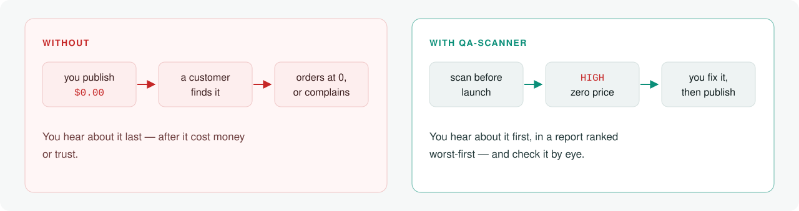
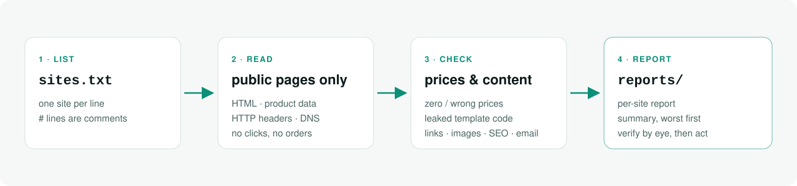
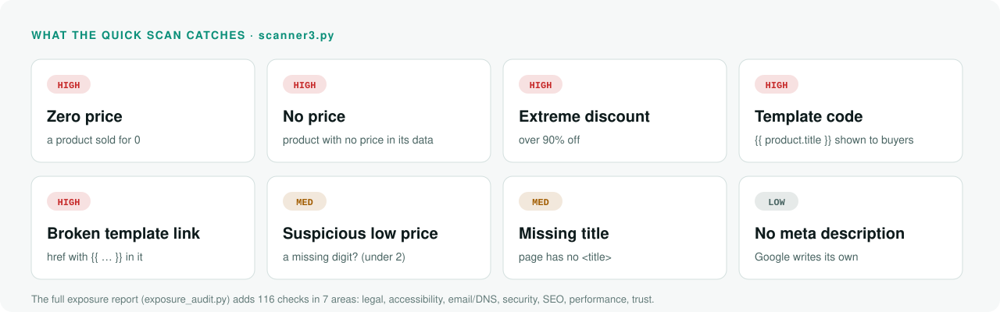
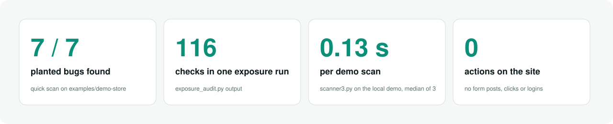
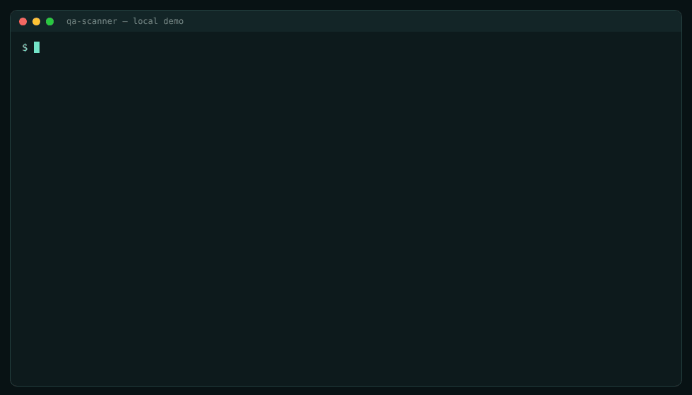
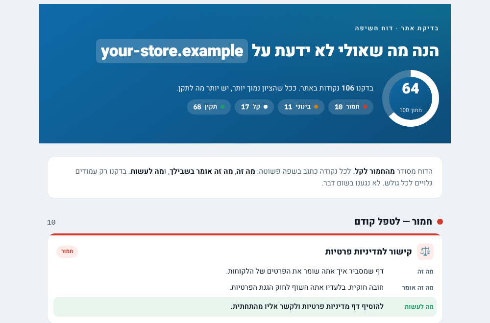
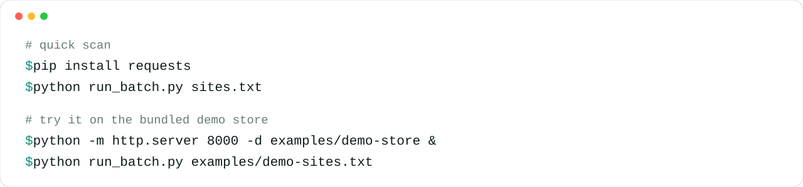

<p align="right"><a href="README.md">עברית</a> · <b>English</b></p>

**▶ Try it now** — inside the repo, on a local demo store; finds 6 high-severity issues. [See it run ↓](#demo)

```bash
pip install requests
python -m http.server 8000 -d examples/demo-store & sleep 1; python scanner3.py http://127.0.0.1:8000/
```

<p align="center"><picture><source media="(prefers-color-scheme: dark)" srcset="assets/hero.svg"><source media="(prefers-color-scheme: light)" srcset="assets/hero-light.svg"></picture></p>

<p align="center">
<a href="https://github.com/meir7651231-ui/qa-scanner/actions/workflows/scan.yml"></a>


</p>

<h3 align="center">Finds the expensive mistakes on a website — before they cost money.</h3>

<p align="center"><a href="#quick-start"><b>Quick start</b></a> · <a href="#the-problem">The problem</a> · <a href="#how-it-works">How it works</a> · <a href="#what-it-catches">What it catches</a> · <a href="#what-it-does-not-do">What it does not do</a> · <a href="#the-numbers">The numbers</a> · <a href="#demo">Demo</a> · <a href="#running-it">Running it</a> · <a href="#whats-inside">What's inside</a> · <a href="#faq">FAQ</a> · <a href="#status">Status</a></p>

---

> **This project is frozen.** The code works and stays as it is; no changes are planned. See [Status](#status) and [ROADMAP.md](ROADMAP.md).

## Quick start

From a clean clone to a report — **under 60 seconds.** Measured: **8.3–9.3 s** (3 runs, no pip cache, on a Linux cloud machine).

```bash
git clone https://github.com/meir7651231-ui/qa-scanner && cd qa-scanner
python -m venv .venv && . .venv/bin/activate        # Windows: .venv\Scripts\activate
pip install requests
python -m http.server 8000 -d examples/demo-store &
python run_batch.py examples/demo-sites.txt
```

Result: `reports/_SUMMARY.md` with one suspect and 6 high findings. On Windows, run the `http.server` line in a separate window. [How to read the report](guides/reading-the-report.md).

## The problem

On a website or online store a small mistake costs real money: a product shown at $0.00, a wrong discount, template code
like `{{ product.title }}` visible to buyers, a broken image, a link to a 404, or a domain anyone can send spoofed email from.
Usually you find out only after a customer complains — or buys at the wrong price.

**qa-scanner walks the site like an ordinary visitor and finds it first.**

<p align="center"><picture><source media="(prefers-color-scheme: dark)" srcset="assets/beforeafter.svg"><source media="(prefers-color-scheme: light)" srcset="assets/beforeafter-light.svg"></picture></p>

## How it works

<p align="center"><picture><source media="(prefers-color-scheme: dark)" srcset="assets/how.svg"><source media="(prefers-color-scheme: light)" srcset="assets/how-light.svg"></picture></p>

1. **List** — put sites in `sites.txt`, one per line (`#` = comment).
2. **Read** — only public data: HTML, the store's official product data, HTTP headers and DNS. It never clicks, orders, tries coupons or logs in.
3. **Check** — prices, content, links, images, SEO and email security.
4. **Report** — a report per site and a summary ranked worst-first, in `reports/`.

Full step-by-step detail, read from the code: [guides/ARCHITECTURE.md](guides/ARCHITECTURE.md).

## What it catches

<p align="center"><picture><source media="(prefers-color-scheme: dark)" srcset="assets/catches.svg"><source media="(prefers-color-scheme: light)" srcset="assets/catches-light.svg"></picture></p>

<details>
<summary>As a table, including the full exposure report</summary>

| Area | Examples |
|---|---|
| Prices | zero price, suspiciously low price, extreme discount (over 90%), product with no price |
| Content | template code shown to visitors (`{{ }}`), placeholder text left before launch |
| Links & images | broken links, images that don't load |
| Real browser | checks what a visitor sees after JavaScript runs (`archive/scanner2.py`, and the exposure report) |
| SEO | missing or long title, missing description, images without alt |
| Email security | SPF · DMARC — straight from DNS |
| Full exposure report | 116 checks in 7 areas: regulation, accessibility, email, site security, SEO, performance, trust — see [guides/auto-audit.md](guides/auto-audit.md) (Hebrew) |
</details>

> ⚠️ The tool reduces mistakes, it doesn't remove them. **Verify every finding by eye** before acting on it.
> Run it only on your own site, or a client's who asked for the check.

## What it does not do

- **It is not a penetration test.** It doesn't try to break in, send payloads, guess passwords or bypass any protection.
- **It reads public pages only** — GET requests only, like an ordinary visitor. No forms, no add-to-cart, no orders, no logins.
- **It doesn't replace a human eye.** Every finding is a suspicion to verify on the page itself.
- **It fixes nothing.** It reports; the fix is yours.
- **Don't scan without permission.** Run it only on your own site, or a client's who asked for the check. The demo in this repo runs on an invented local store.

## The numbers

<p align="center"><picture><source media="(prefers-color-scheme: dark)" srcset="assets/numbers.svg"><source media="(prefers-color-scheme: light)" srcset="assets/numbers-light.svg"></picture></p>

All measured on the local demo store (`examples/demo-store`), not on a real site:

- **7/7** — every bug planted in the store was found by the quick scan (8 findings: 6 high, 1 medium, 1 low — the link with template code is caught twice, as visible code and as a broken link).
- **116** — the number of checks `exposure_audit.py` prints in one run.
- **0.13 s** — median of 3 runs of `scanner3.py` on the demo.
- **0** — actions on the site: the code has no form posts, POST requests, clicks or logins (checked with `git grep`).

## Demo

<p align="center"></p>

The output above is a real run of `scanner3.py` on the local store `examples/demo-store` (every bug in it is planted on purpose; the tool prints Hebrew).
And a sample exposure report (`examples/sample-report.html`, invented data for an imaginary site) — [how to read it](guides/reading-the-report.md):

<p align="center"></p>

## Running it

<p align="center"><picture><source media="(prefers-color-scheme: dark)" srcset="assets/install.svg"><source media="(prefers-color-scheme: light)" srcset="assets/install-light.svg"></picture></p>

### From GitHub (nothing to install)
1. Edit `sites.txt`.
2. **Actions** tab → **qa-scan** → **Run workflow**.
3. When it finishes, download the reports from the `qa-reports` artifact.

### Locally — quick scan
```bash
pip install requests
python run_batch.py sites.txt                   # whole list → reports/_SUMMARY.md + one report per site
python scanner3.py https://your-store.example   # one site, output to the screen
```

### Try it on the demo store (no real site touched)
```bash
python -m http.server 8000 -d examples/demo-store &
python run_batch.py examples/demo-sites.txt     # 1 suspect, 6 high-severity findings → reports/
```

### Locally — full exposure report
```bash
pip install -r requirements.txt                 # requests, beautifulsoup4, lxml, playwright
python exposure_audit.py https://your-site.example --no-render   # no browser
python -m playwright install chromium
python auto_audit.py sites.txt                  # a PDF per site + reports/_SUMMARY.html
```
Full instructions and nightly scheduling: [guides/auto-audit.md](guides/auto-audit.md) (Hebrew).

## What's inside

| File | What it does |
|---|---|
| `scanner3.py` | "Source of truth" engine: reads the store's official product data (e.g. Shopify) and finds wrong prices and content |
| `run_batch.py` | runs `scanner3` over `sites.txt` and writes Markdown reports to `reports/` |
| `exposure_audit.py` | exposure report: 116 checks on one site |
| `make_report.py` | turns exposure findings into a styled HTML/PDF report |
| `auto_audit.py` | runs the exposure report over a list: a PDF per site + a ranked summary |
| `requirements.txt` | every dependency, by feature (no script reads it automatically) |
| `.github/workflows/scan.yml` | CI: runs `run_batch.py` on GitHub Actions and uploads the reports as an artifact |
| `examples/` | a local demo store with planted bugs (`demo-store/`), a demo site list, and a sample exposure report |
| `guides/` | [architecture](guides/ARCHITECTURE.md) · [reading the report](guides/reading-the-report.md) · [automatic exposure report and nightly scheduling](guides/auto-audit.md) (Hebrew) |
| `archive/` | `scanner.py` (HTML crawl) and `scanner2.py` (real browser, Playwright) — early versions, kept as they are |
| `docs/` | a separate GitHub Pages site (guides on email security and prompts) |
| `assets/` | images for this README (every SVG in a dark and a light version) |

## FAQ

<details><summary><b>Does it change anything on the site?</b></summary>

No. It reads public pages and data only, like any visitor. It places no orders, submits no forms and never logs in.
</details>

<details><summary><b>Is this a hacking tool?</b></summary>

No. It doesn't try to bypass any protection and sends nothing beyond ordinary GET requests. See [What it does not do](#what-it-does-not-do).
</details>

<details><summary><b>How do I see it work without scanning someone's site?</b></summary>

Run the local demo store — see [Quick start](#quick-start).
</details>

<details><summary><b>Which scanner should I run?</b></summary>

For stores — `run_batch.py` (it uses `scanner3`). For a full report on one site — `exposure_audit.py` / `auto_audit.py`.
`archive/scanner.py` and `archive/scanner2.py` are earlier versions kept for reference.
</details>

<details><summary><b>Can I trust every finding?</b></summary>

The DNS checks (SPF/DMARC) are reliable. Checks that depend on JavaScript (accessibility, cookie banner) need a look by eye. See [How to read the report](guides/reading-the-report.md).
</details>

<details><summary><b>Why does a cloud run sometimes find nothing?</b></summary>

Some cloud environments have a proxy that blocks browsing to outside sites. On GitHub Actions and on your own machine it works.
</details>

<details><summary><b>Can I contribute?</b></summary>

The project is frozen, but bug and false-positive reports are welcome. See [CONTRIBUTING.md](CONTRIBUTING.md).
</details>

## Status

**Frozen (November 2026).** The code stays as it is, CI on `main` passes, and there is no active development.
[ROADMAP.md](ROADMAP.md) · [CHANGELOG.md](CHANGELOG.md) · [CONTRIBUTING.md](CONTRIBUTING.md) · [SECURITY.md](SECURITY.md)
