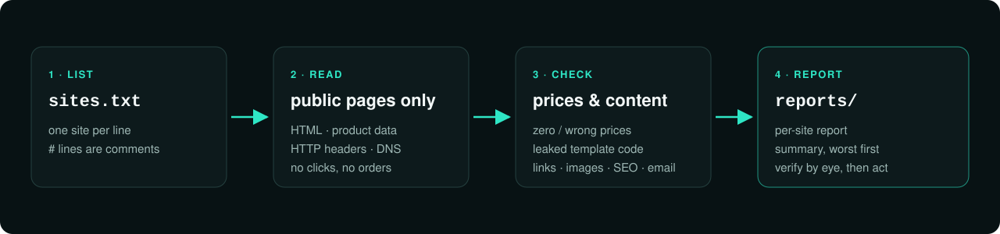

<p align="right"><b>עברית</b> · <a href="README.en.md">English</a></p>

<p align="center"></p>

<p align="center">


<a href="https://github.com/meir7651231-ui/qa-scanner/actions/workflows/scan.yml"></a>
</p>

<h3 align="center">מוצא את הטעויות היקרות באתר — לפני שהן עולות כסף.</h3>

<p align="center"><a href="#הבעיה"><b>הבעיה</b></a> · <a href="#איך-זה-עובד">איך זה עובד</a> · <a href="#מה-זה-בודק">מה זה בודק</a> · <a href="#מה-בפנים">מה בפנים</a> · <a href="#הרצה">הרצה</a> · <a href="#שאלות-נפוצות">שאלות</a> · <a href="#סטטוס">סטטוס</a></p>

---

> **הפרויקט קפוא.** הקוד עובד ונשאר כפי שהוא; לא מתוכננים שינויים. ראו [סטטוס](#סטטוס).

## הבעיה

באתר ובחנות אונליין, טעות קטנה עולה כסף אמיתי: מוצר שמוצג ב־‎$0.00, הנחה שגויה, קוד תבנית כמו
`{{ product.title }}` שמופיע ללקוח, תמונה שבורה, קישור ל־404, או דומיין שכל אחד יכול לשלוח ממנו מייל מזויף.
בדרך כלל מגלים את זה רק אחרי שלקוח התלונן — או קנה במחיר הלא נכון.

**qa-scanner עובר על האתר כמו גולש רגיל ומוצא את זה קודם.**

## איך זה עובד

<p align="center"></p>

1. **רשימה** — שמים אתרים בקובץ `sites.txt`, שורה לכל אתר (`#` = הערה).
2. **קריאה** — הכלי קורא רק מידע ציבורי: HTML, נתוני מוצר רשמיים, כותרות HTTP ו־DNS. לא לוחץ, לא מזמין, לא מנסה קופונים ולא נכנס לשום חשבון.
3. **בדיקה** — מחירים, תוכן, קישורים, תמונות, SEO ואבטחת מייל.
4. **דוח** — לכל אתר דוח, וסיכום מדורג מהחמור לקל, בתיקיית `reports/`.

## מה זה בודק

| תחום | דוגמאות |
|---|---|
| מחירים | מחיר אפס, מחיר נמוך חשוד, הנחה קיצונית (מעל 90%), מוצר בלי מחיר |
| תוכן | קוד תבנית שמוצג למבקר (`{{ }}`), טקסט זמני שנשכח לפני פרסום |
| קישורים ותמונות | קישורים שבורים, תמונות שלא נטענות |
| דפדפן אמיתי | בודק את מה שגולש רואה אחרי שה־JavaScript רץ (`scanner2.py`) |
| SEO | כותרת חסרה או ארוכה, תיאור חסר, תמונה בלי alt |
| אבטחת מייל | SPF · DMARC — ישירות מול DNS |
| דוח חשיפה מלא | 100+ בדיקות ב־7 תחומים: רגולציה, נגישות, מייל, אבטחת אתר, SEO, ביצועים, אמון — ראו [README_AUTO.md](README_AUTO.md) |

> ⚠️ הכלי מצמצם טעויות, לא מבטל אותן. **מאמתים כל ממצא בעין** לפני שפועלים לפיו.
> מריצים רק על אתר שלך, או של לקוח שביקש בדיקה.

## מה בפנים

| קובץ | מה הוא עושה |
|---|---|
| `scanner3.py` | מנוע "מקור האמת": קורא את נתוני המוצר הרשמיים של החנות (למשל Shopify) ומוצא מחירים ותוכן שגויים |
| `run_batch.py` | מריץ את `scanner3` על כל `sites.txt` וכותב דוחות Markdown ל־`reports/` |
| `scanner.py` | הגרסה הראשונה: זוחל על עמודי HTML (requests + BeautifulSoup) |
| `scanner2.py` | אותו רעיון בדפדפן אמיתי (Playwright) — רואה גם תוכן שנטען ב־JavaScript |
| `exposure_audit.py` | דוח חשיפה: 100+ בדיקות על אתר אחד |
| `make_report.py` | הופך ממצאי דוח חשיפה לדוח HTML/PDF מעוצב |
| `auto_audit.py` | מריץ דוח חשיפה על רשימת אתרים: PDF לכל אתר + סיכום מדורג |
| `.github/workflows/scan.yml` | ה־CI: מריץ את `run_batch.py` ב־GitHub Actions ומעלה את הדוחות כ־artifact |
| `docs/` | אתר GitHub Pages נפרד (דפי מידע על אבטחת מייל ופרומפטים) |
| `assets/` | התמונות של ה־README |

## הרצה

### מ־GitHub (בלי להתקין כלום)
1. עורכים את `sites.txt`.
2. לשונית **Actions** ← **qa-scan** ← **Run workflow**.
3. בסיום, הדוחות זמינים להורדה כ־artifact בשם `qa-reports`.

### מהמחשב — סריקה מהירה
```bash
pip install requests beautifulsoup4 lxml
python run_batch.py sites.txt          # כל הרשימה → reports/_SUMMARY.md + דוח לכל אתר
python scanner3.py https://your-store.example   # אתר אחד, פלט למסך
```

### מהמחשב — דוח חשיפה מלא
```bash
python exposure_audit.py https://your-site.example --no-render   # בלי דפדפן
pip install playwright && python -m playwright install chromium
python auto_audit.py sites.txt          # PDF לכל אתר + reports/_SUMMARY.html
```
הוראות מלאות ותזמון לילי: [README_AUTO.md](README_AUTO.md).

## שאלות נפוצות

<details><summary><b>הכלי משנה משהו באתר?</b></summary>

לא. הוא קורא עמודים ונתונים ציבוריים בלבד, כמו כל גולש. לא מבצע הזמנות, לא שולח טפסים ולא מתחבר.
</details>

<details><summary><b>למה ההרצה בענן לפעמים לא מוצאת כלום?</b></summary>

בסביבות ענן מסוימות יש פרוקסי שחוסם גלישה לאתרים חיצוניים. ב־GitHub Actions ועל המחשב שלך זה עובד.
</details>

<details><summary><b>איזה סורק להריץ?</b></summary>

לחנויות — `run_batch.py` (שמשתמש ב־`scanner3`). לדוח מקיף על אתר — `exposure_audit.py` / `auto_audit.py`.
`scanner.py` ו־`scanner2.py` הם גרסאות מוקדמות שנשמרו.
</details>

<details><summary><b>אפשר לסמוך על כל ממצא?</b></summary>

בדיקות DNS (SPF/DMARC) אמינות. בדיקות שתלויות ב־JavaScript (נגישות, באנר עוגיות) — צריך לאמת בעין.
</details>

## סטטוס

**קפוא (נובמבר 2026).** הקוד נשאר כמו שהוא, ה־CI על `main` עובר, ואין פיתוח פעיל.
היסטוריית השינויים: [CHANGELOG.md](CHANGELOG.md) · דיווח על בעיית אבטחה: [SECURITY.md](SECURITY.md).
