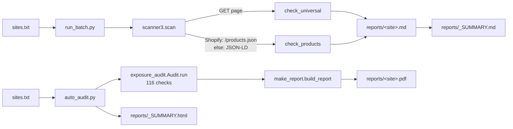

<a href="#עברית">עברית</a> · <a href="#english">English</a>

# Architecture · ארכיטקטורה

כל מה שכתוב כאן נקרא ישירות מהקוד בענף הזה. · Everything here was read directly from the code on this branch.

## עברית

יש בריפו שני מסלולים נפרדים. אף אחד מהם לא שולח טפסים, לא לוחץ ולא מתחבר — רק בקשות GET.

### מסלול 1 — סריקה מהירה (`run_batch.py` → `scanner3.py`)
| שלב | מה קורה בקוד |
|---|---|
| קלט | `run_batch.py` קורא את קובץ הרשימה (ברירת מחדל `sites.txt`), מדלג על שורות ריקות ועל שורות שמתחילות ב־`#`. |
| קריאה | `scanner3.scan(url)` מוריד את העמוד (User-Agent ‏`QA-PreLaunch-Checker/3.0`, ‏timeout של 20 שנ׳). סטטוס 400 ומעלה ← ממצא חמור והסריקה של האתר נעצרת. |
| זיהוי פלטפורמה | `detect_platform` מחפש סימנים ב־HTML: ‏Shopify, ‏WooCommerce, ‏Wix, ‏Magento, אחרת `unknown`. |
| בדיקות כלליות | `check_universal`: קוד תבנית `{{ … }}` גלוי (מחוץ ל־`<script>`), ‏`<title>` חסר או ריק, ‏meta description חסר, קישור שיש בו קוד תבנית. |
| מקור אמת למוצרים | ב־Shopify: ‏`/products.json?limit=250`. אם אין מוצרים משם — Schema.org ‏JSON‑LD מתוך העמוד. |
| בדיקות מוצר | `check_products`: אין מחיר · מחיר 0 · מחיר מתחת ל־2 · הנחה של 90% ומעלה מול `compare_at_price`. |
| פלט | `reports/<site>.md` לכל אתר, ו־`reports/_SUMMARY.md` עם החשודים (רק ממצאים חמורים), התקינים, ואלה שלא נבדקו. שנייה של המתנה בין אתר לאתר. |

### מסלול 2 — דוח חשיפה (`auto_audit.py` → `exposure_audit.py` → `make_report.py`)
| שלב | מה קורה בקוד |
|---|---|
| קריאה | `Audit(url, render)` מוריד את העמוד ב־requests. עם `render=True` מנסה גם לרנדר ב־Chromium (Playwright) כדי לראות תוכן שנטען ב־JavaScript; אם לא מצליח — ממשיך עם ה־HTML הגולמי. |
| בדיקות | `run()` מריץ 12 קבוצות: משפטי, נגישות, מייל/DNS, אבטחה, SEO, ביצועים, אמון, ומדיניות/קטלוג/קישורים/מייל/תמונות לעומק. כל בדיקה נרשמת כ־`(id, group, name, passed, severity, note)`. בהרצה על חנות ההדגמה: 116 בדיקות. |
| DNS | שאילתות DNS-over-HTTPS דרך `dns.google`: ‏SPF ו־DMARC ‏(TXT), ‏MX, ‏DNSSEC ‏(DNSKEY), ‏CAA. |
| דוח | `make_report.build_report` ממיין מחמור לקל, מחשב ציון = אחוז הבדיקות שעברו, כותב HTML ומדפיס ל־PDF ב־Chromium. |
| סיכום | `auto_audit.py` כותב `reports/_SUMMARY.html`, ממוין לפי מספר הממצאים החמורים. |

### CI
`.github/workflows/scan.yml` ‏(`qa-scan`): על push ל־`main` ובהפעלה ידנית — Python 3.12, ‏`pip install requests`, ‏`python run_batch.py sites.txt`, והעלאת `reports/` כ־artifact בשם `qa-reports`.

## English

Two separate paths. Neither submits forms, clicks or logs in — GET requests only.

### Path 1 — quick scan (`run_batch.py` → `scanner3.py`)
| Step | What the code does |
|---|---|
| Input | `run_batch.py` reads the list file (default `sites.txt`), skipping blank lines and lines starting with `#`. |
| Read | `scanner3.scan(url)` fetches the page (User-Agent `QA-PreLaunch-Checker/3.0`, 20 s timeout). Status 400+ → a high finding and that site stops there. |
| Platform | `detect_platform` looks for markers in the HTML: Shopify, WooCommerce, Wix, Magento, else `unknown`. |
| Universal checks | `check_universal`: visible template code `{{ … }}` (outside `<script>`), missing or empty `<title>`, missing meta description, a link containing template code. |
| Product source of truth | On Shopify: `/products.json?limit=250`. If that gives nothing — Schema.org JSON‑LD from the page. |
| Product checks | `check_products`: no price · price 0 · price under 2 · discount of 90%+ against `compare_at_price`. |
| Output | `reports/<site>.md` per site, and `reports/_SUMMARY.md` with suspects (high findings only), clean sites, and sites not checked. One second pause between sites. |

### Path 2 — exposure report (`auto_audit.py` → `exposure_audit.py` → `make_report.py`)
| Step | What the code does |
|---|---|
| Read | `Audit(url, render)` fetches the page with requests. With `render=True` it also tries Chromium (Playwright) to see JavaScript-loaded content; if that fails it continues with the raw HTML. |
| Checks | `run()` runs 12 groups: legal, accessibility, email/DNS, security, SEO, performance, trust, plus deep policy/catalog/links/email/images checks. Each check is recorded as `(id, group, name, passed, severity, note)`. On the demo store: 116 checks. |
| DNS | DNS-over-HTTPS lookups through `dns.google`: SPF and DMARC (TXT), MX, DNSSEC (DNSKEY), CAA. |
| Report | `make_report.build_report` sorts worst-first, computes score = percent of checks passed, writes HTML and prints it to PDF in Chromium. |
| Summary | `auto_audit.py` writes `reports/_SUMMARY.html`, sorted by number of high findings. |

### CI
`.github/workflows/scan.yml` (`qa-scan`): on push to `main` and on manual run — Python 3.12, `pip install requests`, `python run_batch.py sites.txt`, and `reports/` uploaded as the `qa-reports` artifact.
